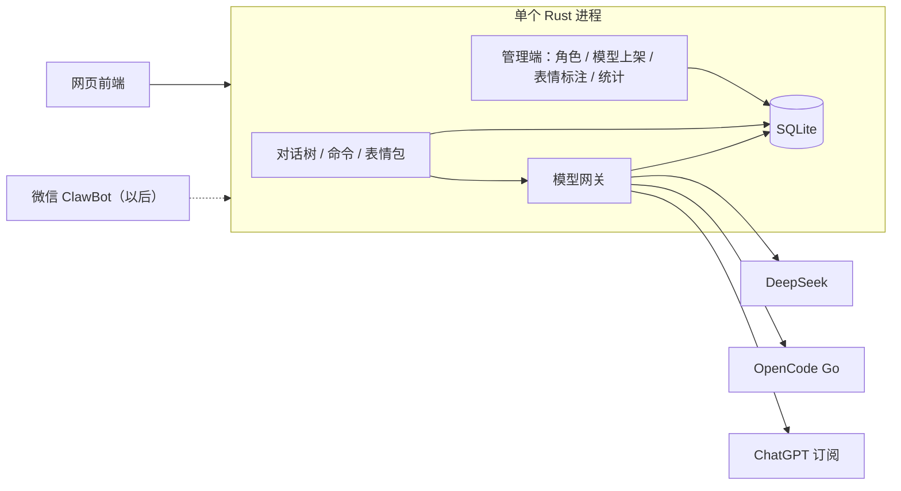

# nekochat 设计文档

日期：2026-10-26
状态：已确认；2026-10-27 按用户新要求改为完整角色卡与全本地 skill 资源包，前端模型/思考档位选择已撤销。

本文写给拿到它就要开工的人。标注 **[我的决定]** 的条目是设计者在对话中自行定下、用户没有明确表态的地方；其余都是用户明确说过的要求。

---

## 1. 这是什么，为什么做

一个自托管的**角色扮演网页聊天**。服务端统一管理各家模型的 API key 和订阅，前端给人用起来要快、要好看：

- 角色扮演（例如猫娘），系统提示词在管理端切换；
- 能把图片和文件发给模型；模型能按角色人设在回复里插入**表情包**（例如 DeepSeek 娘「蓝色大肥鱼」）；
- LaTeX、Markdown、图片显示得好看；
- 输出过程**绝不卡顿**，性能优先于花哨的动态效果；
- 管理端能看到每家模型花了多少钱、额度还剩多少。

核心（服务端）用 **Rust**。这一版只做网页聊天，个人微信 ClawBot 以后作为另一个通道接入，架构上先留好位置。

## 2. 目标、非目标、反目标

### 目标

1. 网页聊天，左侧对话列表 + 中间对话区（详见第 6 节）。
2. 前端选择管理端发布的完整角色卡；实际模型与提供商仅管理端配置，普通聊天接口不返回底层模型信息。
3. 思考档位及其他生成参数绑定角色，由服务端使用；前端既不能选择，也不显示思考等级。
4. 对话是一棵树（仿 pi 的 session tree）：编辑 / 重新生成产生分支，‹ › 切换，`/tree` 浏览整棵树。
5. 命令：`/clear`、`/compact`、`/upload`、`/tree`，只在输入 `/` 后弹出。
6. 每条回复下显示 debug 信息：首字时间、速率、缓存输入、无缓存输入、思考 token、输出 token。
7. 表情包：基于 dsh-nekowhale-stickers 的知识库与规则，模型按标注描述准确选择表情插入回复。
8. 主题可用 CSS 便捷定制，右上角切换；内置 Catppuccin（Latte / Frappé / Macchiato / Mocha）、Gruvbox（Dark / Light）、Claude 娘。
9. 管理端：角色、模型上架、表情包标注、统计监控。
10. 对话可彻底删除。

### 非目标（这一版不做）

- 登录 / 多用户账号 / 每人额度。
- 微信 ClawBot（只留接口）。
- 模型生成图片（表情包只从标注好的素材库里选）。
- Claude 接入（Claude 订阅不允许，见第 3 节；Anthropic API key 以后再加）。
- 任何工具调用、命令执行、文件系统访问——**只做聊天**。
- 一条回复内的多轮模型调用（例如比 max 更高的 `ultra` 档：草稿 → 自查 → 修改）。用户确认暂不做。
- **[我的决定]** 使用者只有部署者本人：不做「主人模式」、不做调用频率与花费上限、不做防套话。以后要给别人用时再补（届时需要区分主人与他人，ChatGPT 订阅与 OpenCode Go 只对主人开放）。

### 反目标（做成这样就算失败，哪怕功能都在）

- 流式输出时掉帧、卡顿，或长对话滚动不流畅。
- 用户端能看到或拿到任何 API key / 订阅凭证。
- 用户端拿到角色的系统提示词、底层模型参数或资源授权配置（公开名称、角色选择和背景图是有意公开的）。
- 模型能触发任何服务器上的操作。
- 删除对话后，内容仍以任何形式残留在服务器上。

## 3. 约束

### 3.1 各家模型的使用条件

| 来源 | 结论 | 依据 / 条件 |
|---|---|---|
| DeepSeek API key | 正常接入，按量计费 | — |
| OpenCode Go | 接入，**风险由用户承担** | 官方文档（opencode.ai/docs/go）写明：仅限单成员 workspace；面向编程 agent 流量并监控滥用。要求客户端发自己的 User-Agent（如 `nekochat/0.1`），并在每个对话里发稳定的 `x-opencode-session` 头。我们必须照做。每次响应里带 `opencode.allowance`（本次计入多少额度）。|
| ChatGPT 订阅（GPT 订阅） | 接入，**仅限本人使用**；**[我的决定]** 放在实现顺序的最后 | 走 OpenAI 官方「Sign in with ChatGPT」开源客户端通道（developers.openai.com/siwc）：动态注册 client、持久化 `ext_agent_host_id`、回调地址是 127.0.0.1 环回、推理走 Responses API（`store: false`, `stream: true`）。服务器在远程主机时按其「Self-hosted VMs」流程：本地完成 OAuth，再把凭证安全拷到服务器。授权绑定用户本人。该通道面向「开源或本机运行」的应用；若最终既不开源又部署在远程服务器，启用前需先走 OpenAI 的申请表。|
| Claude 订阅 | **不接入** | Anthropic 条款禁止在第三方应用里使用 Free/Pro/Max 的 OAuth 凭证。以后接 Claude 走 Anthropic API key。|

### 3.2 表情包授权

dsh-nekowhale-stickers（github.com/Loping151/dsh-nekowhale-stickers）：代码 Apache-2.0，复用代码时保留其 NOTICE；知识库数据 CC BY-NC 4.0。GIF 仍归原作者，依 LICENSE-ASSETS 可在保留作者链接与网址时非商业分享，不得收费或商用，不能把整个图集错误标成 Apache。表情来源被问起时，如实说明作者（B 站「可以叫我云大人/雾雪」，kiriyuki.com），保留形象设计者署名。图片和元数据全部本地保存、本站提供，不使用运行时远程下载。

### 3.3 安全

- 不做登录。前端访问密码由服务端**可选**配置，**默认不设**。
- **[我的决定]** 没设前端密码时，默认只监听 `127.0.0.1`；配置成对外监听却没设密码，启动时打印醒目警告（不阻止启动）。
- **[我的决定]** 管理端**始终**需要管理密码（配置文件里设，未设则管理端不开放）。不把「来自环回地址」当作可信依据——放在同机反向代理后面时，所有请求都来自 127.0.0.1。
- **[我的决定]** 默认不信任 `X-Forwarded-For`；只有在配置里声明了可信代理地址时才采用。nekochat 本身只讲 HTTP，对外访问时由反向代理（推荐 Caddy）或 Tailscale 负责加密；配置成对外监听且设了密码、却没有声明前面有代理时，启动时提示「密码将以明文传输」。
- API key 与订阅凭证**只**放在服务器的配置文件 / 环境变量 / 凭证文件里，**不能**在网页里查看或修改。ChatGPT 订阅登录用命令行子命令完成（例如 `nekochat login chatgpt`），因为它需要环回回调。
- 模型没有任何工具，服务端不执行模型输出的任何内容。
- 用户问过 Docker 是否足够安全：默认容器不是强隔离；如用 Docker 部署，按以下方式加固——非 root 用户、只读根文件系统（数据目录除外）、`cap_drop: ALL`、`no-new-privileges`、不挂宿主目录（数据卷除外）、不挂 `docker.sock`、限制 CPU / 内存。

### 3.4 性能（硬性要求）

见第 9 节，含验收标准。

## 4. 方案取舍

### 4.1 整体架构 —— 选 A

| 方案 | 说明 | 取舍 |
|---|---|---|
| **A 单个 Rust 程序（选定）** | 一个 axum 进程：模型网关 + 聊天 API + 管理端 + 统计；前端静态文件打进二进制；SQLite 单文件 | 部署最简单；前端只和自己的服务通信，key 天然不外泄；微信以后作为新通道模块接入。代价是网关不能单独给 Cursor 等工具用（以后可加 OpenAI 兼容出口）。|
| B 网关与聊天服务拆开 | Rust 网关（管 key/额度/统计）+ Rust 聊天服务 | 网关可复用；但两个服务两份配置，统计和模型信息要跨服务对齐。|
| C 现成网关 + 自写聊天 | LiteLLM / New API + Rust 聊天 | 不用写协议适配；但多一个 Python/Go 服务，与「核心 Rust、轻量」冲突，统计受它的数据模型限制。|

内部按 crate 分层（网关 / 对话 / 通道 / 存储），以后要拆成 B 不难。

### 4.2 前端 —— SolidJS + Rust WASM Worker

| 方案 | 取舍 |
|---|---|
| **SolidJS + Vite（选定）** | 细粒度响应式，流式输出只更新变化的那一块，运行时小。|
| Svelte 5 | 性能接近，但流式更新要自己控制粒度。|
| 全 Rust WASM（Leptos） | WASM 不能直接改 DOM，每次 DOM 操作都经 JS 中转，不比 Solid 快；KaTeX、高亮都在 JS 生态。|

用户问过 WASM 是否更不卡：卡顿主要来自 DOM 更新、主线程上的解析计算、DOM 节点堆积；WASM 只对「纯计算」有帮助。因此：**页面用 SolidJS；Markdown 解析用 Rust（pulldown-cmark）编译成 WASM，放在 Web Worker 里跑；KaTeX 与代码高亮也在同一个 Worker 里跑。** 服务端与前端共用同一个 Markdown 解析 crate，以后做微信时服务端转纯文本 / 图片，两边对「块」的切分一致。

长上下文本身在服务端处理，浏览器只受「历史消息多」的影响，靠虚拟滚动解决。

### 4.3 表情包选择 —— 准确优先，目录直接给模型

| 方案 | 取舍 |
|---|---|
| 情绪词 + 服务端随机挑 | 省 token，但不准：nekowhale 知识库 322 张里「开心」一类就有 63 张。用户明确要求准确优先，**否决**。|
| **目录直接给模型（选定）** | 把角色可用表情按「名字｜情绪｜适用场景」一行一张放进系统提示词，模型写 `[sticker:名字]`。全部 322 张约 7000 字（估约 5000 token）。目录每轮不变，命中提示词缓存后成本和首字延迟可忽略。|
| 工具调用（search → send） | 最准、库再大都行；但每次发表情多一轮请求，要求每家模型支持工具，与「只做聊天」冲突。表情库涨到上千张时再考虑。|

### 4.4 模型接入 —— 自写薄适配层

用 reqwest + SSE 解析自写三种协议适配：

- OpenAI Chat Completions（DeepSeek；OpenCode Go 的开源模型，如 GLM、Kimi、DeepSeek、MiMo）
- OpenAI Responses（ChatGPT 订阅；OpenCode Go 的 GPT、Grok 等）
- Anthropic Messages（OpenCode Go 的 Claude Haiku、MiniMax M3 等；以后的 Anthropic API key）

已按 OpenCode 文档确认（opencode.ai/docs/go 的 Endpoints 表、/v2/docs/console/api/inference）：Go 的端点前缀是 `https://opencode.ai/inference/go/`，按模型分属 `openai/v1/chat/completions`、`openai/v1/responses`、`anthropic/v1/messages`、`google/v1beta/models/<model>` 四个协议族；模型列表在 `https://opencode.ai/inference/v1/models`；花费与额度在 `usage.cost`、`usage.opencode.allowance`、`usage.opencode.tokens` 里（Chat Completions 需带 `stream_options.include_usage`）。**[我的决定]** Gemini 协议族这一版不做，管理端上架时不显示这类模型。

DeepSeek 已按其文档确认：思考开关 `thinking.type`（`enabled`/`disabled`），强度 `reasoning_effort`（`low`/`high`/`max`），思考内容在 `reasoning_content`，缓存计数在 `usage.prompt_cache_hit_tokens` / `prompt_cache_miss_tokens`；不带工具时历史回复的 `reasoning_content` 无需回传。

不用通用 SDK 的原因：需要拿到准确的缓存 / 无缓存 / 思考 token 计数，需要发 OpenCode Go 要求的请求头，需要管理 ChatGPT 订阅的令牌刷新——通用 SDK 往往把这些藏起来。

## 5. 系统结构

- **通道（channel）**：网页是第一个通道。通道负责把「回复事件流」（文字块、表情、思考、用量）转成各自的展示形式。微信通道以后实现同一接口，届时需要服务端把 LaTeX / Markdown 转成图片或纯文本。
- **网关**：统一的「发起一次补全」接口，输入是标准化的消息列表 + 模型 + 思考强度，输出是标准化事件流 + 用量。每次调用写一条用量记录。
- **角色卡（通道无关）**：绑定模型、生成参数、提示词和资源包授权；Rust 起轮服务负责执行，Web / 微信等适配器负责呈现。资源核心输出文字与资源引用，不依赖 HTML、DOM、SSE 或微信协议。

## 6. 用户端（聊天页）

样稿在 brainstorm 会话里确认过（布局 A 的第三、四、五版）。

### 6.1 布局

- 左侧栏：「＋ 新对话」、对话列表。悬停对话出现 🗑（彻底删除）。
- **[我的决定]** 桌面优先，手机可用：窄屏时侧栏收成抽屉；🗑、编辑、重新生成等悬停才出现的操作在触屏上改为点按消息后出现；`/tree` 面板支持点选。
- 顶栏：对话标题；**右上角主题切换**（下拉，按 Catppuccin / Gruvbox / 其他分组，每项带三个色点预览）。
- 对话区：用户消息右侧气泡；回复上方显示该轮的角色公开名称，不显示底层模型；思考过程仍默认折叠为「▸ 思考了 N 秒」，点开看全文。
- 输入框：平时只显示「输入消息…」，**不显示命令**；右侧只有角色选择器，不显示模型、提供商或思考档位控件。
- 管理端可为角色上传本地形象背景图，默认不设；单独装饰层以可配置透明度显示，不随 token 更新、不阻挡交互。

### 6.2 角色选择器

- 仅列出管理端启用、已绑定可用模型的角色公开名称，按角色排序；角色参数、提示词与资源授权列表不向聊天端返回。
- 角色可以绑定同一个模型的不同参数或不同提示词；前端选择角色即选择整套配置。
- 对话中途切换角色从下一轮生效，保留消息树；每条回复保存角色及公开名称快照，不改写旧消息。重新生成/编辑使用当前选择的角色。
- 底层模型、提供商和价格仍以真实调用记录供管理端统计，不能用角色名取代计费身份。
- 官方 ChatGPT 订阅使用 SIWC OAuth 动态注册和公开 Responses API；订阅角色在输入框旁显示套餐使用提示与管理用量入口，不暴露精确模型或思考档位。普通用户不登录，授权、账号切换与凭证刷新仅由管理端统一控制。

### 6.3 管理端生成参数

- 角色绑定思考强度，以及实际协议支持的 temperature、top_p、输出上限、seed、penalty、stop 等；采用严格字段，不允许覆盖消息、认证或工具配置。
- 思考档位必须在所绑定模型支持列表内；未覆盖时使用服务端模型默认值。
- 普通请求只提交角色 id，不能传模型/effort/parameters 覆盖；前端不显示思考等级，但保留时长、思考内容与 token debug。

### 6.4 命令

输入 `/` 才弹出列表，Tab 补全：

| 命令 | 行为 |
|---|---|
| `/clear` | 彻底删除当前对话的整棵树（不可恢复），对话本身保留为空对话 |
| `/compact` | 压缩**当前分支**的上下文，见 7.3 |
| `/upload` | 选择图片或文件上传（拖拽、粘贴同样可用） |
| `/tree` | 打开对话树面板，见 7.2 |

### 6.5 debug 行

每条回复下方一行等宽小字，颜色区分：

| 字段 | 定义 |
|---|---|
| 首字 | 发出请求到收到第一个输出（含思考）token 的时间 |
| 速率 | 输出 token（含思考）÷（最后一个 token 时间 − 第一个 token 时间） |
| 缓存输入 | 上游返回的缓存命中输入 token |
| 无缓存输入 | 上游返回的未命中输入 token |
| 思考 | 上游返回的思考 token（不支持则不显示） |
| 输出 | 上游返回的输出 token（不含思考） |

**[我的决定]** 聊天页不显示花费，花费只在管理端统计页看（用户列的 debug 项里没有花费）。

### 6.6 彻底删除

- 🗑 删除对话：确认弹窗写明「聊天记录、上传的图片和文件会从服务器上一起删掉，无法恢复」。
- 删除内容包括：全部节点、压缩摘要、附件文件。
- **[我的决定]** SQLite 开 `secure_delete`，删除后做一次 WAL checkpoint，保证内容不残留在数据库文件的空闲页里；日志里不写任何聊天内容。
- **[我的决定]** 「彻底」的范围是本程序自己的存储：数据库、附件文件、日志。不防范拿到整块磁盘镜像后做取证恢复（SSD、写时复制文件系统、Docker overlay 上已删除的数据块），也不涵盖各家模型提供商自己保留的数据。
- 用量记录保留（时间、模型、提供商、各类 token、花费），但不含任何内容，且与已删对话解除关联。

### 6.7 主题

- 全部颜色走 CSS 变量；一个主题 = 一个 CSS 文件。
- 内置：Catppuccin Latte / Frappé / Macchiato / Mocha（用官方色板）、Gruvbox Dark / Light（官方色板）、Claude 娘。
- **[我的决定]** Claude 娘色板起点：浅底 `#faf9f5`、主色 `#d97757`、正文 `#141413`，构建时可微调。
- **[我的决定]** 自定义主题：把 CSS 文件放进数据目录的 `themes/`，自动出现在切换菜单里。
- 选择记在浏览器 localStorage。

## 7. 对话树

### 7.1 数据模型（仿 pi）

参考 pi（`@earendil-works/pi-coding-agent` 的 `dist/core/session-manager.js`）：

- 每个节点有 `id`、`parent_id`；对话有 `leaf_id` 指向当前位置。
- 新消息挂在 `leaf_id` 下面并成为新 leaf。
- 切换分支 = 改 `leaf_id`。
- 发给模型的上下文 = 从 `leaf_id` 沿 `parent_id` 走到根再反转（遇到压缩节点按 7.3 处理）。
- 同一父节点下的子节点互为兄弟分支：编辑用户消息 = 给它加兄弟；重新生成 = 在同一条用户消息下再挂一个回复。
- 不做 pi 的「离开分支时 LLM 总结」（那是给编程 agent 的，聊天分支是平行备选）。

### 7.2 交互

- 每条有兄弟的消息下方显示 `‹ 2/3 ›`；用户消息有「✎ 编辑」，回复有「↻ 重新生成」。
- `/tree` 面板：树状列出整棵对话（用户消息与回复区分颜色，当前位置高亮），↑↓ 选择、Enter 跳转。
  - 选中用户消息：把文字放回输入框，编辑发送后产生新分支（同 pi）。
  - 选中回复：从该回复之后继续，输入框为空。

### 7.3 `/compact`

- 只作用于当前分支：在当前 leaf 后插入一个「压缩节点」，记录摘要文本和「从哪个节点开始保留原文」（仿 pi 的 `firstKeptEntryId`）。
- 构建上下文时，遇到压缩节点：用摘要替代它之前的内容，再接保留的原文。
- 其他分支不受影响。
- 摘要由当前选择的模型生成（使用一段固定的压缩提示词，需保留角色语气相关的关键信息）。
- **[我的决定]** 除手动 `/compact` 外，当前分支上下文超过所选模型上下文窗口的 85% 时自动压缩（阈值可配置、可关闭）。模型上下文窗口在管理端模型设置里维护。

## 8. 表情包

基于 dsh-nekowhale-stickers 做。

### 8.1 数据

- 采用其知识库格式（`meta/nekowhale.json`）：每张表情有 `id`、`hash`、`emotion`、`tags`、`use`（适用场景）、`desc`（画面描述）、`meme`（梗出处）、`dir`（双人表情方向，如 `大肥鱼→GPT娘`）、`en`。
- 首批数据：导入其 322 张（两套：大肥鱼、大肥鱼和 GPT 娘）的标注与图片；保留作者署名与链接。
- 用户自己上传的表情包使用同样字段。

### 8.2 标注流程（管理端）

参考其 `tools/annotate`：上传 → 动图抽帧拼成一张预览图 → 交给一个支持看图的已上架模型逐张生成全部字段初稿（标注提示词参考其 `PROMPT.md`）→ 管理员在管理端审阅、修改后生效。

### 8.3 与角色绑定

每个角色配置：

- 可用的本地 skill 资源包；未勾选的包不进入该角色提示词和表情选择范围；
- 身份写法 `self`（表情是角色自己，例如角色就是大肥鱼）或 `neutral`（第三方表情包，例如猫娘使用大肥鱼表情）——避免模型说「我用大肥鱼给你发」；
- 发表情频率 `rare / normal / often`（参考其 HINTS 文案，`often` ≈ 闲聊里每两三条回复发一个）。用户要求表情要积极使用，猫娘、大肥鱼这类角色默认 `often`。

### 8.4 提示词

系统提示词 = 角色提示词 + 表情身份段（self / neutral，参考其 PERSONA）+ 发表情规则 + 频率提示 + 表情目录。

- 发表情规则沿用其 SKILL.md：一条回复最多一个表情；表情补充语气、不替代回答；用户认真解决问题时少发；不预告、不询问是否要发；名字里的「猫猫」「喵喵」是大肥鱼的猫系动作；被问出处时如实说明作者。
- 目录每行：`名字｜情绪｜适用场景`（双人表情附方向）。
- 系统提示词按固定顺序生成，只在管理员修改角色或表情配置时改变，平时**逐字节不变**，保证上游提示词缓存命中。

### 8.5 解析与发送

- 模型在回复里写 `[sticker:名字]`。
- 服务端在流中拦截标记：遇到 `[sticker:` 先缓住，直到 `]` 再决定，**前端永远不会看到半截标记**。
- 解析顺序：名字精确匹配 → 名字 / 标签模糊匹配 → 都失败则静默去掉标记。
- 同一回复超过一个表情时只保留第一个；最近几条回复里发过的表情不重复（被去重的同样静默去掉）。
- 前端在原位置内联显示表情图（GIF 原样播放）。

### 8.6 本地 skill 目录

- 每个资源包一个目录：`SKILL.md`（静态使用说明）、`pack.json`、`stickers.json`、`assets/` 与授权/署名文件。不执行包内脚本，也不给模型文件系统工具。
- 内置完整「大肥鱼」「大肥鱼和 GPT 娘」两套标注及 322 张图片。自定义包放数据目录 `skills/<pack_id>/`，由服务端读取清单管理；角色编辑器按包勾选。
- 图片与背景全部本地管理，浏览器只访问本站素材接口；运行时不热下载、不重定向至上游，不用外链失败后的假图替代。
- 背景默认不用图片。管理员可上传安全的本地图片或选取本地资源，按角色设置透明度。
- 同一资源引用可交给网页图片渲染器或未来微信图片发送器，包的数据、授权、精确选择与去重策略不复制到各个前端。

## 9. 前端性能（硬性要求）

1. 流式 token 先进缓冲区，每个 `requestAnimationFrame` 最多更新一次 DOM。
2. Markdown 按块增量渲染：已完成的块冻结不再重算，只重新解析最后一块。
3. Markdown 解析（Rust pulldown-cmark → WASM）、KaTeX、代码高亮全部在 Web Worker 里；公式和代码在所在块完成后才渲染。
4. 长对话虚拟滚动，只渲染可见消息。
5. 不做打字机等动画效果。
6. **验收**：模拟 100 tok/s 的流式输出，在已有 500 条消息（含公式、代码、表情）的对话中，主线程无超过 50 ms 的长任务（用 PerformanceObserver `longtask` 测），滚动保持 60 fps。**[我的决定]** 参考环境：桌面 Chromium，DevTools 开 4× CPU 降速（模拟中端手机）；另在一台真实手机上人工检查一遍流畅度。

## 10. 管理端

单独入口，受管理密码保护（见 3.3）。

### 10.1 角色

- 字段：内部名称、公开显示名、实际模型、模型参数、系统提示词、本地可选背景与透明度、启用与排序、勾选的资源包、`self` / `neutral`、发表情频率。
- 设置「新对话使用的角色」；只有可用角色发布给聊天端。
- 管理员更新角色后下一轮使用新配置；用户显式切换角色时从下一轮使用新角色，原有消息树与名称快照保持。
- 大肥鱼角色可用 dsh-nekowhale-stickers 的 PERSONA `self` 文案作为起点；它只有身份设定，性格、说话风格、口头禅需要管理员自己写。

### 10.2 模型上架

- 每接入一家提供商（配置文件里写 key / 凭证），管理端从其模型列表接口拉取全部模型，可手动刷新。
- 管理员选择哪些模型可用于角色绑定；未上架的服务端拒绝调用，模型目录本身不直接展示到聊天前端。
- 每个上架模型设置：显示名、排序、**协议**（Chat Completions / 标准 Responses / 官方 ChatGPT 订阅 Responses；Messages 尚未接入）、支持的思考档位与默认档、是否支持图片输入、上下文窗口、价格（缓存输入 / 无缓存输入 / 输出，每百万 token）。官方订阅协议按预览限制仅允许 effort。
- 提供商的模型列表接口只返回模型 ID（已实测 OpenCode 的 `/inference/v1/models`），所以协议、档位、价格都靠内置默认值或手填。
- 内置常见模型的默认值（例如 OpenCode Go 文档的价格表），上架时自动填，可改；查不到的留空手填。
- 模型默认值用于角色编辑时的参数继承；新对话入口以默认角色为准，而非暴露默认模型给用户。

### 10.3 统计监控

- 各提供商 / 各模型的花费（按价格表和用量记录计算）。
- ChatGPT 订阅的用量旁放「管理用量」链接（指向 chatgpt.com/settings/usage），按 OpenAI UI 规范。
- 额度剩余：

| 提供商 | 数据来源 |
|---|---|
| DeepSeek | 余额接口 |
| OpenCode Go | 累加每次响应的 `opencode.allowance`，对照其 5 小时 / 每周 / 每月三档上限（每模型分别计） |
| ChatGPT 订阅 | 按 OpenAI 实际返回的用量信息显示；拿不到的只显示 token 用量 |

- 时间 × token 二维图，不同模型用不同颜色区分。

## 11. 上传

- 图片：发给支持图片输入的模型；当前模型不支持时，发送前提示用户换模型。
- **[我的决定]** 文本类文件（txt、md、代码、csv、json 等）作为文本内容附在消息里；PDF 在服务端抽取文字后同样处理；其他类型拒绝并提示。
- 图片附件存本地 SQLite（数据目录内），关联对话和节点，随对话彻底删除；历史、编辑、重新生成和分支切换都保留对应图片。

## 12. 部署与配置

- 交付物：单个二进制（前端打包在内）+ 一个配置文件 + 一个数据目录（SQLite、附件、表情图、自定义主题、凭证文件）。
- 配置文件：监听地址、前端访问密码（可选）、管理密码、各提供商的 key / 凭证文件路径。
- 可选 Docker 部署，加固项见 3.3。

## 13. 留给构建者决定

- crate 划分、数据库表结构、前后端之间的 HTTP / SSE 接口格式。
- 图表库（倾向轻量高性能，如 uPlot）、代码高亮库（需能在 Worker 里跑）。
- 对话标题怎么生成。
- 上传大小限制、动图抽帧数量。
- 压缩提示词与标注提示词的具体措辞。
- 各家模型列表接口、余额接口、ChatGPT 订阅用量信息的具体调用方式（按各家文档确认）。
